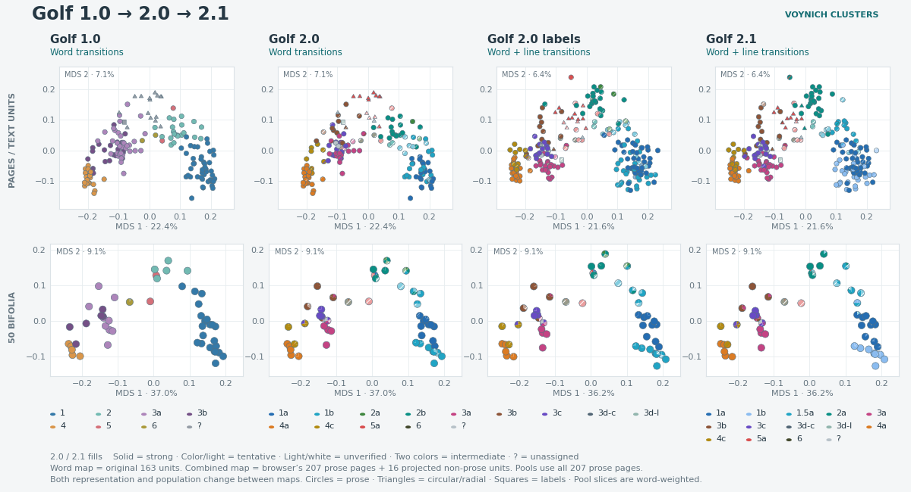

# Voynich Clusters

Expanding Currier's voynich languages beyond A / B

Voynich Clusters explores similarities between manuscript pages using
Jensen–Shannon divergence between word and joined-line transition matrices.

**Current classification — Golf 2.1, reviewed 10 October 2026**

- [Page classifications and scores](golf-classifications.csv) includes current
  Golf 2.1 memberships and path v2 scores for 225 pages/panels. Separate
  paragraph and all-text columns retain the outlier, neighbor and short-text scores.
- [Complete Golf 2.1 assignments](golf-v21-assignments.csv) covers all 302
  page/text-kind units, including labels, with support and adjudications.
- [Explore Golf 2.1](index.html#golf-v21) or [open the MDS viewer](index.html#mds).
- [Transition matrices and MDS data](research-data/README.md) provides complete
  word and joined-line transition counts and probabilities, pairwise JS
  matrices, all positive MDS dimensions, saved branch coordinates and path
  projections as CSVs. It includes a NumPy reproduction script and source hashes.

### From Golf 1.0 to Golf 2.1

[Forum PNG, 1200 × 650](golf-evolution.png) · [Vector SVG](golf-evolution.svg) ·
[Plotted coordinates](golf-evolution-coordinates.csv)

The first two columns reproduce the original Golf 2.0 word-transition map's
163 jointly fitted units with at least 80 words. The last two reproduce the
interactive viewer's combined-profile map, first with Golf 2.0 labels and then
Golf 2.1. That map fits 207 paragraph pages and projects 16 non-prose units.
The move between maps therefore changes both representation and fitting
population. The last two columns isolate the change in labels.
The separate bifolium row retains all 50 paragraph pools from 207 pages,
including short pages. Slices show page memberships weighted by word count.

The Golf regimes come from npcompl33t's
[analysis of languages beyond Currier A/B](https://www.voynich.ninja/thread-6084.html).
Golf is the project's internal name for those classifications. The viewer also
includes [René Zandbergen's language classifications](https://www.voynich.nu/extra/rz_lang.html).

Golf 2.0 adds the revised profile assignments from the 8 October 2026 membership
audit. Golf 1.0, 2.0 and 2.1 appear in the overview and are available as matrix
groupings. Diagonal stripes identify six intermediate candidates. They retain
their exported working membership while their candidate boundaries remain unconfirmed.

The **Golf V2** tab reproduces 11 saved faceted transition figures and eight
internal label comparisons as interactive JavaScript plots. Select a point to
inspect its exact counts, denominators and assignment. Page circles use the same
support fills as the overview. Diamonds identify pooled bifolia or within-page
blocks, which do not have page-level support ratings. Grey crosses are unassigned
or outside the comparison. Coordinates and rates remain unchanged. The accompanying tables
show conditional transition rates, TF-IDF word examples and LSA associations.
Append `#golf-v2` to the site URL to link directly to this tab. Switching tabs
updates the URL, and browser Back and Forward restore the selected tab.
The branch view defaults to 225 pages without labels, using each page's largest
P/C/R text kind, with prose winning ties. This is a display rule, not a joint
whole-page classification. Labels and all text kinds are separate options,
covering up to 17 profiles and 227 pages. Dashed relationships remain provisional,
and the tree's spacing does not represent measured distance.

**No audit recommendation** means the audit withheld a recommendation. It does
not mean no working classification or affinity exists. Page details retain the
previous preliminary class, nearest-profile affinity, alternatives, and the
reason for withholding a recommendation. Grouping uses the explicit membership
export's version 2 working assignments. The export retains a previous class with
uncertainty when the audit abstains; nearest affinity never determines membership.
Full-color fills show strong support. Diagonal stripes in the group color and a lighter shade show tentative support,
and lighter fills with white diagonal stripes show unverified membership.
The exported `assignment_support` field
determines these levels. Strong support includes validated bifolium assistance;
unverified does not mean probably wrong. Key counts follow the selected view.
Diagonal stripes in the two candidate colors show intermediate cases without an
additional support pattern. Their support remains in details, exports and key
counts. Grey cells
have no established working class. Each unit appears only in its working group;
candidate alternatives are shown in its details. The strict and
supported analysis masks remain separate.
Repeatability percentages identify their target affinity and are not assignment
confidence scores.

Page details include Golf's authored case discussions where available, with
source attribution. Units without a separate writeup receive a clearly labeled
explanation of their saved audit measurements. The supporting table separates
page evidence, assistance from its bifolium, and the whole-bifolium comparison.

Golf 2.0 identifiers follow its codebook, including 3c Stars-T, 4c Stars-S,
3d-c Rosette circles, 3d-l Rosette labels and 6 f58. V2 uses distinct hues rather
than lightness variations of the original Golf colors. Herbal B uses pink and
brown; Stars uses violet and gold. Lighter fills indicate qualified support.

## Golf 2.1 and MDS

The **Golf 2.1** tab shows the reviewed combined word- and joined-line
classification, including the four A profiles 1a, 1b, 1.5a and 2a. Its branch
chart retains support levels and intermediate candidates. Eleven comparisons
show page and bifolium transition rates alongside transition tables. These
descriptive features come from frozen reference profiles; the plots are not
independent validation of the assignments. Label and other non-prose assignments
retain their previous audit support unless explicitly reviewed.

The **MDS** tab embeds the interactive branch viewer, including page and pooled
bifolium views, branch-specific fits and Golf 2.0 comparisons. Its combined
divergence gives equal weight to word and joined-line transition JS. The main
cluster map still displays **word-transition JS**, even when grouped by Golf 2.1.

Use `#golf-v21` or `#mds` to link directly to these tabs.
[Download the Golf 2.1 assignments](golf-v21-assignments.csv) for the complete
reviewed page/text-kind membership export with support and adjudication fields.

## The manuscript path

**Default ordering: sequence / path collection v2, Path 1.**
Golf **2.1** remains the classification version. Path **v2** is a separately
versioned ordering dataset; the memberships have not changed.

The default uses both RF/basic EVA and ZL/Zattera with equal weight, both lambda
settings (0.01 / 0.05) with equal weight, the best eligible fit per sample,
and pairwise consensus across all sections. Every path retains the existing
1a-before-1b eligibility condition. Scores count how often an observation is
later than its peers in the same retained fits, with half weight for ties.
Lower is earlier; these are descriptive scores, not probabilities or dates.

| Path ID | Ending conditions |
| --- | --- |
| **1 (default)** | Overall consensus; no ending filter |
| **2** | 3a before 3b; Bio 4a before Stars-S 4c |
| **3** | 3a before 3b; Stars-S 4c before Bio 4a |
| **4** | 3b before 3a; Bio 4a before Stars-S 4c |
| **0 (legacy)** | Original proposed v1 path |

The default places group-median scores in the remaining directions, 3b before
3a and 4c before 4a, for both pages and bifolia. It nevertheless combines all
eligible endings. Variants filter by the named group-median directions before
choosing each sample's best eligible fit. Support counts are reported because
some samples have no eligible fit for a particular scenario.

Both **Sequence** and **Curves** open on v2 and share a path selector, including
the original proposed path as **Path 0**. Existing views, colors, MDS
coordinates and point interactions are retained. V2 scores update the section
chart, table, offsets and variation statistic. The smooth v2 lines are display
guides at fixed consensus scores, not a single ElPiGraph fit. Historical fit
overlays are labeled legacy. The original held-out statistic and its intervals
are restored only with the legacy selector; they are not attributed to v2.

The [Golf 2.1 assignments CSV](golf-v21-assignments.csv) preserves all 302
classification rows and appends `path_collection_version`, `default_path_id`,
`page_path_score`, `bifolium_path_score`, corresponding ranks, and explicitly
numbered score/rank columns for the three alternates (e.g. `page_path_2_score`
and `bifolium_path_2_score`). The wide datasets use `path_1_score` through
`path_4_score`, with corresponding ranks and retained-fit counts. The default
ID is `1`. Numerical IDs replace the earlier long descriptive IDs without
changing any scores. The old `*_path_position`
columns are archived. Page paragraph scores are repeated across text-kind
rows; pool scores are repeated across constituent pages. Non-paragraph-only
pages have blank v2 page scores. Pages and bifolia use different peer
populations, so their difference is not a geometric residual along one curve.

- [V2 page dataset](path-v2/pages.csv) and [bifolium dataset](path-v2/bifolia.csv)
- [Method, exact path names and reproduction](path-v2/README.md)
- [Selected fit identifiers and objectives](path-v2/selected-fits.csv)
- [Machine-readable definitions, support and source hashes](path-v2/collection.json)
- [V2 chart data](sequence-paths-v2.json)
- [Archived original Golf 2.1 CSV with v1 path positions](archive/path-v1/golf-v21-assignments.csv)
- [Archived historical classifications](archive/classifications/golf-classifications.csv)
- [Archived original path methods](archive/path-v1/path-methods.md)

Use `#curves` and `#sequence` for direct links. A specific path can also be
linked as `sequence.html?path=2` (and likewise `curves.html`); Path 1 is the
default. Earlier long IDs still work in URLs and saved selections. The
[path definitions](path-v2/README.md) document their numerical equivalents.
The historical MDS/path research exports remain frozen references; they do
not define the current downstream default.

## Explore the manuscript

- Compare pages in the matrix, select individual pairs, and zoom into patterns.
- Regroup the overview by section, Currier language, Golf regime, RZ language,
  LFD hand, quire, or bifolium, with breaks between the selected groups.
- Inspect outlier scores and external distances, and download charts or data.

## Page classifications and scores

[Download the current Golf 2.1 assignments CSV](golf-v21-assignments.csv) for
the reviewed membership export with v2 path scores. Each row represents a page
and text kind, including labels, circular text and radial text. The
[historical Golf 2.0 export](archive/classifications/golf-v2-assignments.csv)
is retained unchanged for comparison.

[Download the page classifications CSV](golf-classifications.csv) for all 225
pages and panels in the viewer, in manuscript order. Each row gives the Golf
classification and bifolium, followed by separate `paragraph_` and `all_` scores.
Unassigned pages are retained. These are the viewer's existing classifications.
The `golf_v21_` fields contain the current reviewed membership, support,
intermediate boundaries and written adjudication. `golf_v21_text_kind` identifies
the controlling text kind. Historical Golf 1.0/2.0 fields are available in
the [archived classification CSV](archive/classifications/golf-classifications.csv),
not the default CSV. The numerical outlier and neighbor scores retain their
original word-transition basis.

The following Golf 2.0 field descriptions apply to that **archived** CSV:
The `golf_v2_assignment_code` and `golf_v2_assignment_id` columns give authoritative
working membership. `golf_v2_assignment_source` and `golf_v2_assignment_status`
record its provenance and qualification. These match Golf's `page_membership.csv`
for the controlling text kind on each page.
`golf_v2_assignment_support` gives Strong support, Tentative support, Unverified
membership or Unassigned. Detailed assignment and audit statuses remain separate.
The separate `golf_v2_class` and `golf_v2_code` columns retain the audit ID and code,
text kind, assessment status, intermediate-candidate flag and competing profile
IDs. A blank Golf V2 class means no audit recommendation. Previous working class,
nearest affinity, reference membership, recommendation provenance and analysis
masks have separate columns. `golf_v2_display_class` and `golf_v2_placement_source`
record working membership placement separately from the audit recommendation.
Membership labels, support tiers, evidence basis and warnings carry the
qualifications. Affinity repeatability has its own target-profile column and
must not be read as confidence in the retained assignment.

Nearest and second-nearest external JS values include small samples and exclude
the page's own bifolium. The two neighbors may share a bifolium with each other.
JS values are in bits. The outlier score uses the nearest external page that
meets the sample rules, divided by internal split-half JS. Its reference page
and distance are included because it can differ from the unrestricted nearest
neighbor. Blank outlier scores mean the page does not meet the sample rules or
has zero internal JS.

The isolation percentile range compares equally short samples from Early A,
using random words and contiguous windows. Higher values mean greater isolation
for the word count. Comparisons with fewer than five source bifolia are marked
as limited. Blank percentiles mean the page was not studied or had no qualifying
sources. Entirely blank paragraph fields mean the page has no paragraph profile.
For f57v, `all_no_singletons` identifies the 68-word isolation comparison that
excludes 124 single-unit words and filters comparison pages too. Its other
all-text metrics still use all 192 words.

## Text and method

Paragraph text is the default and covers 207 pages and panels. All text adds
circular and radial text, covering 225. Both use the ZL transcription and exclude
labels. Text categories follow the transcription's locus codes.

Golf 2.0 classifies text kinds separately. Paragraph mode uses the prose
assignment. All-text mode groups a page by its largest included text kind, with
prose winning ties; selected-page metadata retains every text-kind result.
Label text never controls a page's matrix placement. All-text distances still use the full
selected text, so the grouping is not a new classification of combined text.

Assignments remain fixed within each text kind. Ward clustering orders pages within
each group. Between groups, the map minimizes the sum of square roots of median
cross-bifolium JS distances between neighboring groups. Golf V2 preserves its
hierarchy, Golf 1.0 keeps 3a and 3b together, and RZ permits any class order.
Whole-group reversals then minimize page distances across block boundaries.
Unassigned pages remain last. This display ordering does not establish new
branches or change any classifications. The diagonal compares alternating line halves within a page.
Outlier scores compare the nearest page on another bifolium against this
within-page variation. Ranked pages require at least 60 words and 20 per half.

For studied pages, a separate ranking compares isolation with equally short
samples from longer pages. Choose a reference regime to inspect the percentile
range from random words and contiguous windows. This measure requires neighbors
on two distinct external bifolia. Comparisons with fewer than five source
bifolia are displayed separately without a rank. Unstudied pages have no score.
For f57v, this ranking uses 68 words after excluding single-unit words from the
page and its comparison material. This exception is labeled in the viewer;
the matrix and scatterplot retain the full selected text.

Sparse text and the distance geometry limit interpretation. Clustering and
outlier scores are exploratory rather than tests establishing distinct languages.
The viewer's expandable method notes describe the calculations in more detail.

## Reproduce from text with ElPiGraph

See [Text-to-order code and commands](text-order/README.md) to refit the published scores from raw ZL/RF transcriptions, or run the documented ElPiGraph engine on your own text. The published fit uses Golf anchors, an Early-A-to-Bio/Stars orientation, and the 1a-before-1b filter; alternate paths add their named ending constraints. These are inputs, not discoveries of historical direction. The custom-text command uses unlabeled starts, no group-order filters, and reports both equally valid directions. `path-v2/reproduce.py` remains the exact saved-fit consensus replay.

## Ordering stability

The [Stability tab](index.html#stability) opens the [full writeup](chronology-stability/index.html), with [figures](chronology-stability/figures.html), [frozen data and replication code](chronology-stability/replication.html), and a [concise forum methodology](chronology-stability/FORUM_METHODS.md). It includes ElPiGraph resampling ensembles, H-coordinate continuation at lambda 0.01, the original scEGRET continuity calculations, and the completed simulation calibration and actual f58/astro/stars removal follow-up. The reports retain scale- and noise-model-sensitive findings, detection-power limits, and the sparse-bin exclusion that prevents isolating f58 as a bridge.
