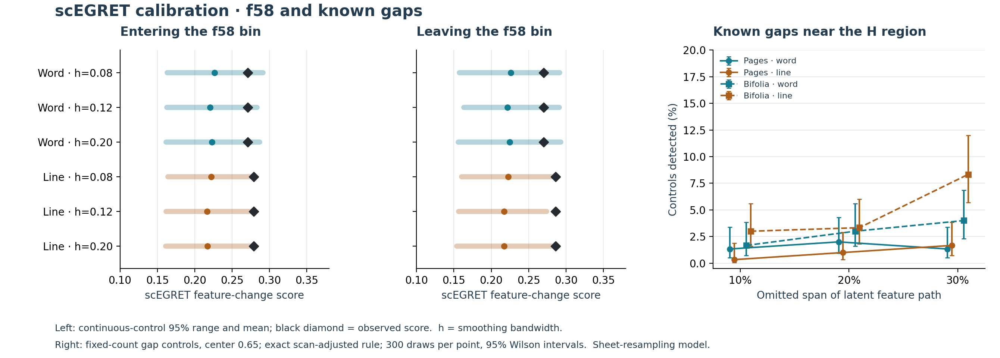

# scEGRET calibration: what the f58 signal does and does not establish

**Completed 16 October 2026.** 147,888 production simulated datasets, with continuous references, deliberate missing-state controls, held-out false-alarm checks and a separate calibration of the two-sided excursion diagnostic. The original 648 R evaluations remain unchanged. [Full numerical tables](tables.html) · [Audit](audit.json) · [Reproduction](../REPRODUCE.md).

**Requested removal follow-up:** [Remove f58 and astro/stars material](omission_test/report.html). Some post-removal screens do flag the newly compared neighbors, depending on count scaling and noise model. The follow-up preserves both positive and negative results and explains the minimum-bin-size limitation.

## The answer

**The calibrated screening does not robustly identify f58 as a discontinuity. It also has too little demonstrated power under the empirical sheet-noise model to establish that the region is continuous.** The earlier claim that the two-sided contrast established a “distinct pocket” was too strong. It is an observed contrast whose statistical distinctiveness had not been established.

This is a substantive change in the interpretation, not a change to the original feature scores. Both the normalized adjacent-score screen and the supplementary two-sided test fail to single out f58 under the primary calibration. The primary result is consistent across all three smoothing bandwidths. Some other section boundaries are more exceptional relative to their local sampling variability, although that does not identify a historical gap or settle their ordering.



In the first two panels, the colored interval is the central 95% of simulated scores under the continuous sheet-resampling reference; the colored dot is its mean, and the black diamond is the observed score. These are reference distributions of a feature-change statistic, not confidence intervals for chronology. The right panel reports how often known missing-state controls were detected, with uncertainty from 300 simulations per point. A low detection rate limits what can be concluded from a negative screen.

## What happened at f58

The original 12-bin page view puts **f58r, f58v, f67v2, f69r and f70r2** together in bin 8. Its adjacent bins contain 21 and 25 profiles. The comparison is therefore between a five-profile mixed bin and substantially larger neighbors. The individual f58 profiles are not unusually short: they contain 2,060 and 1,980 within-word transition events, compared with a cohort median of 498. Small bin occupancy and sheet dependence, rather than unusually short f58 texts, are the relevant sampling concerns here.

At the primary smoothing bandwidth, the sheet-resampling reference gives:

| Features | Boundary | Observed score | Continuous-control 95% range | Local tail | Scan tail before cross-channel adjustment |
|---|---|---:|---|---:|---:|
| Line | 7 → 8 | 0.279 | 0.162–0.275 | 0.018 | 0.606 |
| Line | 8 → 9 | 0.286 | 0.156–0.274 | 0.010 | 0.535 |
| Word | 7 → 8 | 0.271 | 0.163–0.284 | 0.059 | 0.868 |
| Word | 8 → 9 | 0.270 | 0.163–0.291 | 0.073 | 0.943 |

The line scores are locally elevated: approximately 1–2% of corresponding continuous simulations reach those values. But f58 was noticed after inspecting the manuscript and several views. Accounting for that scan makes these modest local elevations unexceptional. Even **before** the extra adjustment across channels and cohorts, their scan tails are about 0.54–0.61. A reported adjusted tail of 1 is a capped comparison result, not a 100% probability that the route is continuous.

The earlier two-sided argument compared the changes into and out of bin 8 with the direct change from bin 7 to bin 9. We separately calibrated its exact diagnostic, `B = min(E7,8, E8,9) − E7,9`. The observed values are **0.101 for word** and **0.102 for line** features. Continuous sheet-resampling controls produce an equal or larger value about **24%** and **22%** of the time, respectively. This pattern is not exceptional even as a local comparison.

There is a direct reason: the **same small middle bin enters both comparisons**. If sampling or sheet variation moves its average away from the neighboring averages, both adjacent scores rise together while the outer-bin comparison is unaffected. Thus two adjacent jumps are not two independent confirmations of a pocket. A curved but continuous feature path can also produce the pattern. This diagnostic was our interpretation of EGRET's all-bin scores; it is not a discontinuity test introduced by the authors.

Removing f58r/v makes the middle bin shrink from five to three profiles, which fails the source code's strict >3 occupancy rule. Removing the three other profiles leaves two, also ineligible. Therefore the apparent disappearance of the flag after either omission cannot isolate f58 as its cause. [Omission accounting](attribution.json) and [descriptive feature/subgroup contrasts](feature_attribution.json) preserve these exclusions. The subgroup contrasts are not additional calibrated significance tests.

## Known missing-state controls: detection is not reliable enough to prove continuity

We performed two complementary positive-control experiments. First, following the paper's validation logic, remove actual contiguous spans from simulated continuous datasets and compare them with equally sized random removals. Recompute binning, feature eligibility and scores after every omission. The sparse-bin rule is part of the experiment, not bypassed. All 72 conditions, with three locations and three widths, are in the [tables](tables.html).

Second, to test the **identical adjusted decision rule** used for the manuscript, keep observed sample sizes, totals and bin occupancy fixed and omit a known interval of latent feature development. Its remaining coordinate is compressed back to the observed range. At a join near H (position 0.65), the empirical sheet-resampling model gives:

| Unit / features | 10% latent gap | 20% latent gap | 30% latent gap | Held-out continuous false alarms |
|---|---:|---:|---:|---:|
| Pages / line | 0.3% | 1.0% | 1.7% | 0.6% |
| Pages / word | 1.3% | 2.0% | 1.3% | 1.0% |
| Bifolia / line | 3.0% | 3.3% | 8.3% | 1.8% |
| Bifolia / word | 1.7% | 3.0% | 4.0% | 0.6% |

Each detection percentage uses 300 draws and the same scan-adjusted threshold as the observed test; continuous false-alarm rates use 500 independent draws. A detection means the altered trajectory is flagged somewhere in the scan, not necessarily that the exact injected join is localized. Full Wilson intervals are retained. The gap widths are fractions of a simulated latent feature path, **not percentages of missing manuscript pages or elapsed historical time**. Broad gaps can still have weak feature contrast when development over that region is gradual relative to empirical variation. These controls show why absence of an H flag cannot certify continuity.

The alternative Dirichlet–multinomial model has substantially greater power in some conditions: for a 30% latent gap near H, page word and line detection rates are about 54% and 88%. That improvement is model-dependent. At primary bandwidth it simulates only about 171 detected word features where the observed pages have 214, and it does not preserve empirical feature covariance or within-sheet dependence. Its apparent sensitivity cannot simply be substituted for the more conservative empirical-noise result.

## Other findings and sensitivity exceptions

The normalized page scan flags the transition from predominantly **1a** to predominantly **1b** in the 10-bin view in both channels at the primary bandwidth. The 12-bin word view also flags the mixed later-Herbal/Stars bin's transition into **Bio 4a** at that bandwidth; this is not a consistently replicated Bio/Stars ordering result. Raw-count scores flag additional boundaries, including 1b to 1.5a. Raw counts are sensitive to text length as well as composition. [Every qualifying sheet-model boundary](tables.html) is retained; [summary.json](summary.json) includes the exact bin composition and members.

There is an important exception to any blanket statement that “nothing near H was flagged”: under the Dirichlet–multinomial model, **raw-count pooled** boundaries touching the H-containing bin do pass the adjusted screen. Those flags do not persist under sheet resampling or per-million scaling. That pooled bin also contains four 3a, two 3b and one 5a pool alongside H. They are model- and scale-sensitive contrasts of a broad mixture, not an isolated detection at f58. These exceptions are retained in the numerical data, not silently discarded.

Pooling therefore remains a change of resolution and observation definition. It neither resolves the page-level continuity question nor supplies the internal Bio/Stars information already lost when both groups share a bin. This calibration does not change the ElPiGraph ordering ensembles or the H-coordinate sensitivity frontier; those measure different properties of the fit.

## Method and relation to the source research

[Zheng et al. (2023), Figures 1–2 and Methods](https://doi.org/10.1093/bib/bbad356) use continuous trajectories, missing intermediates and random downsampling to validate the EGRET screen. We used that validation structure with manuscript-specific count and sampling models. We retained the [published EGRET calculation](https://github.com/qingshanni/scEGRET) and its actual source thresholds. **The manuscript noise generators, simulation-tail calibration, multiplicity adjustment and bypass diagnostic are our adaptations, not procedures claimed to be supplied by the paper.** The paper's illustrative 0.5 flag is not treated as a universal cutoff.

The continuous references follow Gaussian-kernel mean transition proportions along the fixed original Golf order. Bandwidths 0.08, 0.12 and 0.20 are fixed sensitivity choices; 0.12 is primary. These bandwidths describe the simulated reference's smoothness and are unrelated to the elastic fitting penalty lambda. The primary model resamples whole-sheet residual patterns in square-root frequency space, preserving empirical feature covariance and sheet dependence approximately. The sensitivity model uses moment-fitted Dirichlet–multinomial overdispersion. Both preserve observed profile totals. No private or unpublished work is an input.

For each model/cohort/channel/bandwidth, 400 draws estimate each boundary's baseline mean and standard deviation; a disjoint 999 draws calibrate the largest standardized score across all boundaries, three bin resolutions and two scales; a further 500 check false alarms. A factor of four covers the two channels and two cohorts without assuming independence. The supplementary bypass analysis also accounts for the additional statistic family. Simulation tails use `(1 + exceedances)/(999 + 1)`. The unadjusted within-channel 5% scan false-alarm rates range from 2.0% to 7.0% across the 24 reference models; intervals and all diagnostics are available. Positive-control streams are separate.

These are **conditional simulation references**, not exact p-values after fitting the order and reference to the same data. They do not establish that either noise generator is the manuscript's true process. Including all observed variation in the residual library may make the primary screen conservative; the alternative model's covariance restrictions can make it optimistic. Smoothness assumptions matter because an arbitrarily fast continuous curve can interpolate any finite observations. No universal test of all possible continuous histories is available from these data alone.

## Reproduction

From the parent study directory, run:

```
python scegret_independent_audit.py
python calibration/run_calibration.py
python calibration/matched_power.py
python calibration/bypass_calibration.py
python calibration/summarize.py
python calibration/replay_reference.py
python calibration/build_report.py
```

The original-R audit checks all 648 cases again. Monte Carlo runs use its independently validated exact NumPy score, with an additional fast-scorer comparison; this changes execution speed, not the EGRET formula. Seeds, sample counts, source hashes and full retained results accompany the code. Synthetic feature matrices are generated in memory and discarded. The [initial design](DESIGN.md), [matched-rule addition](MATCHED_DESIGN.md) and [bypass addition](BYPASS_DESIGN.md) state when each decision was made, including that the additions followed inspection of preliminary results.

The calibration applies to feature continuity **conditional on the original Golf order**. It does not rerun every candidate trajectory, rank historical chronologies, discover a branch, date a section or reconstruct the missing H bifolia. Its practical conclusion is narrower and clear: **f58 remains a candidate worth investigating, but scEGRET has not established a discontinuity there, and the available negative screen cannot exclude one.**

[Return to the main study](../report.html) · [Figures](../index.html) · [PNG](calibration.png) · [SVG](calibration.svg)
