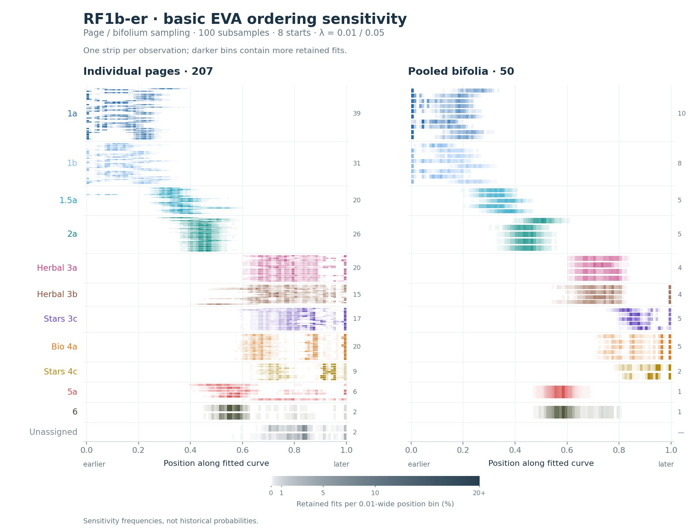
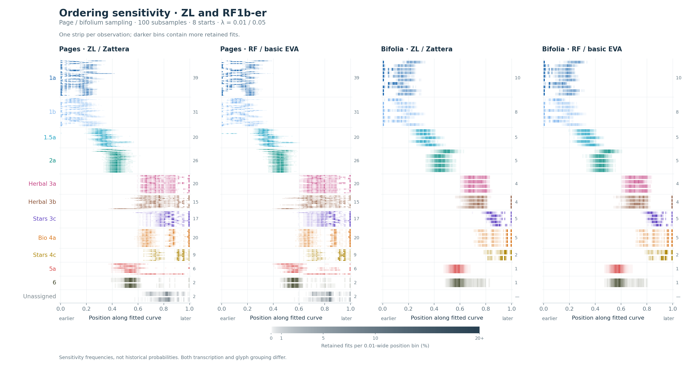
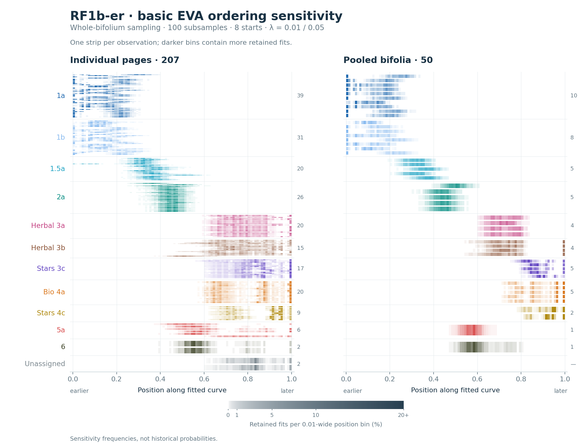
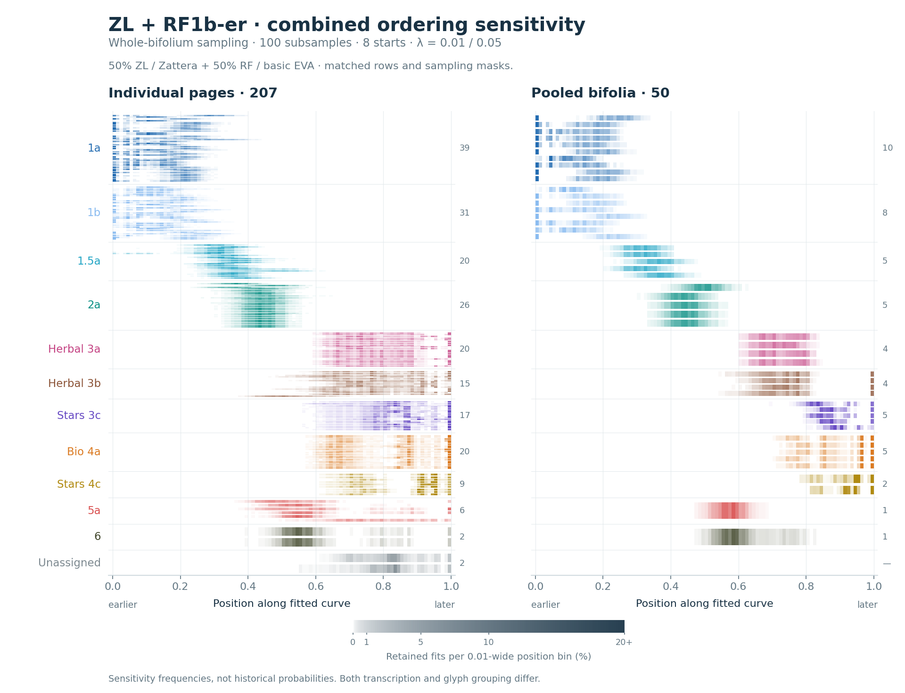

# RF1b-er / basic EVA: ordering stability

Completed 16 October 2026. **4,800 new ElPiGraph fits**, compared with the frozen 4,800-fit ZL ensemble. All 207 paragraph pages and 50 pooled bifolia match. [Design](DESIGN.md) · [Reproduction](REPRODUCE.md) · [Numerical comparison](comparison.json) · [Fit audit](ensemble_audit.json) · [Original ZL report](../golf_published_stability_20261016/report.html).

This is the requested RF1b-er transcription with **individual EVA characters**: for example, `ch` becomes separate `c` and `h` transitions, and `ee` contains two `e` characters. The existing ZL analysis uses **Zattera glyph groups**. Both transcription and unitization change, so differences cannot be attributed to transcription alone. Golf labels and sheet membership remain fixed. The same paragraph cohort has 34,618 readable RF words versus 34,977 ZL words; source readings and word boundaries are retained rather than forced into agreement.

## RF1b-er separately

[PNG](ordering_rf1b.png) · [SVG](ordering_rf1b.svg) · [Chart data](ordering_rf1b_data.json)

## Both representations together

[PNG](ordering_combined.png) · [SVG](ordering_combined.svg) · [Chart data](ordering_combined_data.json)

The combined chart averages the two retained-fit frequency histograms **50:50 for each observation**. It preserves separate modes, rather than replacing alternatives with a bell curve. Equal weight is an explicit sensitivity-design choice, not a probability that either representation is correct. The shared masks mean these are paired experiments, not twice as many independent samples.

## Where the representations differ

[PNG](ordering_comparison.png) · [SVG](ordering_comparison.svg) · [Chart data](ordering_comparison_data.json)

Each horizontal strip is one page or pooled bifolium. Its darker portions are positions reached more often among fits retaining that observation. Multiple separated dark portions indicate alternative placements. The same Golf colors, row order, position bins and opacity scale are used in every panel. Rows are grouped by their fixed Golf labels, not sorted into a new chronology. Positions are normalized arc length in each fitted curve: 0 and 1 indicate the oriented ends, not dates. Coordinates from different representations need not have the same intermediate metric meaning; the combined view deliberately includes that coordinate sensitivity.

## B-section ordering

The following compares the best recovered candidate **within each sample and penalty**, restricted to fitted outcomes whose group medians put 1a before 1b. This is an outcome filter, not a hard ordering constraint. The denominator is the number of samples with an eligible candidate. It is not a posterior probability. “Before” compares group medians; individual pages may interleave. These ordering tables use projections of all reference profiles to define group medians, as in the original competition analysis. The frequency strips themselves use retained observations only.

- **Pages, λ=0.01:** 3a-before-3b wins 44/100 ZL samples and 19/100 RF samples. Bio-before-Stars 4c wins 2/100 and 0/100, respectively.
- **Pages, λ=0.05:** 3a-before-3b wins 24/100 ZL samples and 29/100 RF samples. Bio-before-Stars 4c wins 13/100 and 8/100, respectively.
- **Bifolia, λ=0.01:** 3a-before-3b wins 58/100 ZL samples and 43/100 RF samples. Bio-before-Stars 4c wins 1/100 and 0/100, respectively.
- **Bifolia, λ=0.05:** 3a-before-3b wins 23/100 ZL samples and 19/100 RF samples. Bio-before-Stars 4c wins 0/100 and 0/100, respectively.

| Sampling unit | λ | ZL: 3a before 3b | RF: 3a before 3b | ZL: Bio before Stars 4c | RF: Bio before Stars 4c |
|---|---:|---:|---:|---:|---:|
| Pages, individual sampling | 0.01 | 44/100 | 19/100 | 2/100 | 0/100 |
| Pages, whole-sheet sampling | 0.01 | 38/100 | 24/100 | 2/100 | 1/100 |
| Pages, individual sampling | 0.05 | 24/100 | 29/100 | 13/100 | 8/100 |
| Pages, whole-sheet sampling | 0.05 | 25/100 | 27/100 | 24/100 | 17/100 |
| Pooled bifolia | 0.01 | 58/100 | 43/100 | 1/100 | 0/100 |
| Pooled bifolia | 0.05 | 23/100 | 19/100 | 0/100 | 0/100 |

The frequency charts retain all starting solutions, including less competitive local optima. The table above supplies their score context. The complete [within-sample competition results](ensemble_competition.json) also report when only one of the two directions was recovered; absence from this finite search is not evidence that an alternative is impossible.

The next table uses **all eight starts**, matching the frequency charts, and separately counts paired runs whose group-median direction reverses between representations. Matching the mask and starting permutation does not guarantee that optimization reaches corresponding local minima. Ties remain in the denominators and are recorded separately in the JSON; the complement of a “before” percentage can include ties as well as the opposite direction.

| Sampling unit | λ | Relation | ZL frequency | RF frequency | Paired strict reversals |
|---|---:|---|---:|---:|---:|
| Pages, individual sampling | 0.01 | 3a before 3b | 49% | 45% | 34/800 |
| Pages, individual sampling | 0.01 | Bio before Stars 4c | 60% | 55% | 49/800 |
| Pages, whole-sheet sampling | 0.01 | 3a before 3b | 46% | 43% | 38/800 |
| Pages, whole-sheet sampling | 0.01 | Bio before Stars 4c | 60% | 55% | 50/800 |
| Pages, individual sampling | 0.05 | 3a before 3b | 50% | 49% | 10/800 |
| Pages, individual sampling | 0.05 | Bio before Stars 4c | 45% | 49% | 26/800 |
| Pages, whole-sheet sampling | 0.05 | 3a before 3b | 49% | 46% | 29/800 |
| Pages, whole-sheet sampling | 0.05 | Bio before Stars 4c | 44% | 47% | 38/800 |
| Pooled bifolia | 0.01 | 3a before 3b | 49% | 46% | 20/800 |
| Pooled bifolia | 0.01 | Bio before Stars 4c | 48% | 47% | 9/800 |
| Pooled bifolia | 0.05 | 3a before 3b | 60% | 56% | 40/800 |
| Pooled bifolia | 0.05 | Bio before Stars 4c | 44% | 39% | 39/800 |

## f58 and f86v4

These are retained-fit 5th–95th percentile position spans, using individual-page sampling and all starts. They describe sensitivity, not statistical confidence intervals. A span can bridge low-frequency gaps between modes; use the strips above to see those modes.

| Page | λ | ZL position span | RF position span | Equal-weight combined span |
|---|---:|---:|---:|---:|
| f58r | 0.01 | 0.495–0.592 | 0.492–0.609 | 0.495–0.601 |
| f58v | 0.01 | 0.498–0.587 | 0.507–0.778 | 0.499–0.609 |
| f86v4 | 0.01 | 0.418–0.586 | 0.440–0.543 | 0.422–0.569 |
| f58r | 0.05 | 0.509–0.584 | 0.526–0.598 | 0.514–0.594 |
| f58v | 0.05 | 0.513–0.586 | 0.527–0.616 | 0.517–0.604 |
| f86v4 | 0.05 | 0.447–0.643 | 0.479–0.628 | 0.468–0.634 |

## Whole-bifolium sampling control

Pages from a physical sheet are removed together in this control. The pool fits are unchanged because pools already are sheets. Native page sampling permits remaining pages on the same sheet and is therefore a different uncertainty design. The controls use the original shared sheet masks.

[PNG](ordering_rf1b_sheet_control.png) · [SVG](ordering_rf1b_sheet_control.svg)

[PNG](ordering_combined_sheet_control.png) · [SVG](ordering_combined_sheet_control.svg) · [Side-by-side control](ordering_comparison_sheet_control.png)

## Method and checks

The ensemble follows Albergante et al. (2020), [section 2.10 and Figure 1C](https://doi.org/10.3390/e22030296), using ElPiGraph 0.3.4. For each representation, each page/pool setting has 100 independent Bernoulli 90% inclusion masks, eight starting group orders and λ=0.01/0.05; μ=0.1 and the unbranched curve grows to 28 nodes before the original fixed-topology refinement. Pages receive equal total weight per physical sheet; pools have equal weights. The original package's weighted-wrapper issue is handled using exactly the same verified explicit-mask procedure. The full design includes page-point, page-sheet and pooled-sheet ensembles.

RF word and joined-line conditional transition matrices use individual EVA letters. Counts are pooled before normalization. The two base-2 JS matrices are averaged equally, with the same at-least-three-outgoing-observations eligibility rule and unrenormalized row weights as ZL. Classical MDS keeps all positive eigenvalues above 1e-10, giving 196 RF page dimensions and 49 pool dimensions. Each representation's geometry and group-centroid anchors remain fixed during resampling. This measures fit sensitivity conditional on those inputs; it does not resample transcription uncertainty or refit MDS in each draw.

The eight group permutations are the **same ZL-selected starts** as the original ensemble, with centroids recomputed in RF geometry. No fitted ZL curve is passed into RF. This holds search coverage constant; it is not a new exhaustive search for all RF-specific routes. Golf labels are retained for comparison rather than inferred again from RF.

The same counting implementation reproduces every frozen ZL transition count and both distance matrices exactly. An independent JS implementation agrees with RF within 1.2×10⁻¹⁶. The native/explicit-mask RF pilot agrees to numerical precision, and a saved ZL ensemble fit replays exactly. Two RF production records also match their pre-production checks exactly, including their full-dimensional node hashes. All 4,800 production RF fits converged, and masks, weights, labels, starting permutations and run identities match across representations. The [input checks](inputs.json), [execution verification](execution_verification.json), [production replay checks](production_replay_verification.json), [ensemble audit](ensemble_audit.json) and [paired comparison](comparison.json) retain details. Six single-BLAS-thread workers completed the production fitting in 10.8 minutes. No private or unpublished source is used.

The [RF1b-er source](https://www.voynich.nu/data/RF1b-er.txt), source checksums, compact result records and replication scripts are retained. This is an ElPiGraph stability comparison; it does not rerun the scEGRET continuity calibration or H-coordinate influence map.
